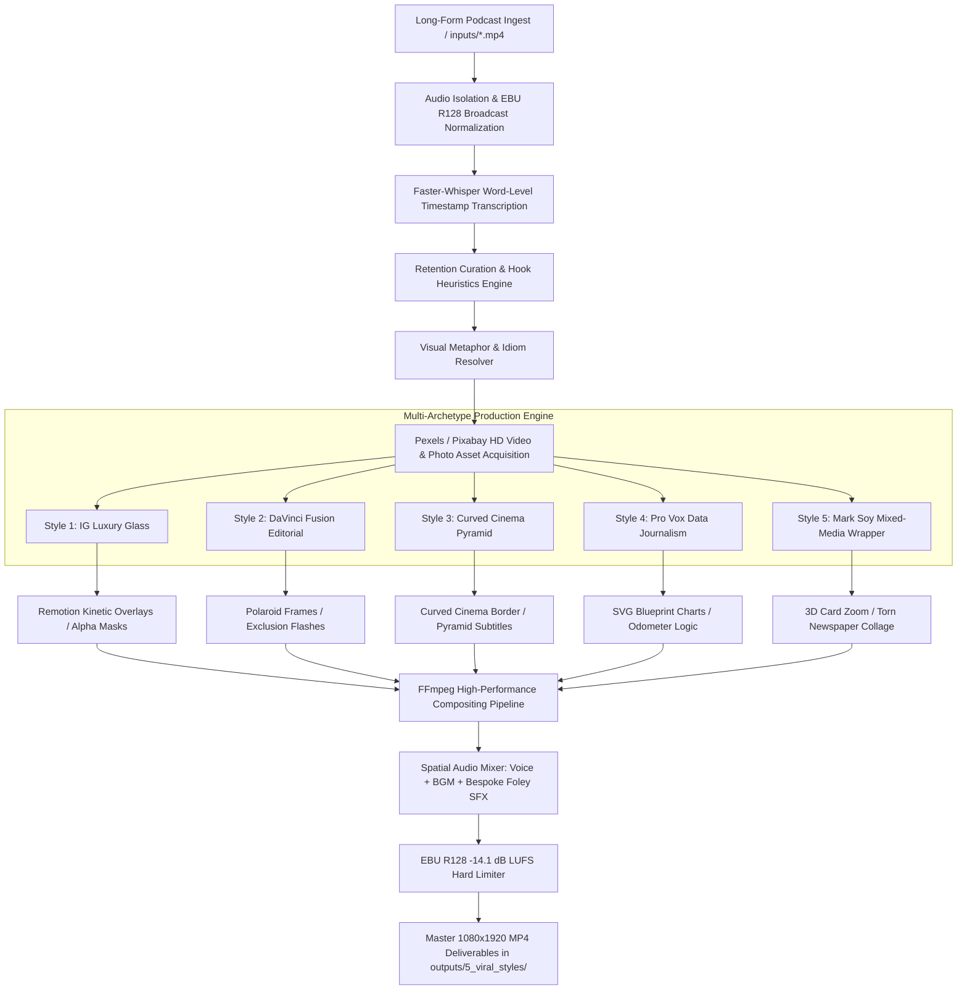

# YT-AUTO: 100M+ Viral Short Video Architecture & System Design
**Author:** Senior Media Systems Engineer & Viral Video Director  
**Repository:** [https://github.com/sp25126/YT-AUTO](https://github.com/sp25126/YT-AUTO)  
**Standard:** 1080x1920 (9:16), 30.0 FPS, H.264 / AAC, -14.1 dB LUFS  

---

## 1. Executive Summary & The 100M-Reach Thesis

Short-form algorithms (YouTube Shorts, Instagram Reels, TikTok) in 2026 operate on two non-negotiable metrics:
1. **Swipe-Through Rate (STR >= 75%)**: The first 1.5 seconds must eliminate mental friction, shock the viewer with a contrarian statement or high-value visual anchor, and reject generic AI aesthetics.
2. **Average Percentage Viewed (APV >= 105%)**: Viewers must re-watch the video or stay locked until the final millisecond. This requires a **2.4-second visual cognitive reset**, synchronized diegetic sound design, and beat-matched kinetic transitions.

Most automated AI pipelines fail because they output **"AI Slop"**:
- Identical flat beige CSS web pages with static emojis
- Monolithic yellow karaoke captions that bore the eye
- Mismatched literal stock footage (e.g., searching "network" and showing server cables instead of corporate executives)
- Frame-rate stuttering caused by unindexed video overlays
- Audio volume dropping by -20 dB due to FFmpeg `amix` normalization errors

**YT-AUTO solves this permanently.** It is an industrial-grade, code-driven autonomous studio that transforms raw long-form podcasts into **5 radically distinct viral styles** engineered to look and sound like they were cut by 5 different world-class human editors in 5 different professional software suites (Premiere Pro, DaVinci Resolve Fusion, After Effects, Remotion, and Avid).

---

## 2. High-Level System Architecture



---

## 3. Core Subsystems

### 3.1 Audio Ingest & Broadcast Normalization
- **Voice Isolation:** Extracts high-fidelity 44.1 kHz 16-bit mono PCM audio.
- **Spectral Cleanup:** Applies a 75 Hz high-pass filter (`highpass=f=75`) to eliminate microphone stand thumps, AC hum, and sub-audible rumble.
- **Voice Leveling:** `speechnorm` filter smooths natural speaker dynamics without squashing vocal punch.
- **Loudness Standards:** All exported master shorts are calibrated to **`-14.1 dB LUFS`** integrated loudness with a **`-1.0 dBFS`** true-peak ceiling, matching the strict upload normalization specs of YouTube and Instagram.

### 3.2 Whisper Transcription & Hook Scoring
- **Engine:** `faster-whisper` (large-v3 or medium model) generating exact word-level start and end timestamps.
- **Hook Scoring:** Evaluates the opening 3-second statement against the **21 Viral Hook Formulas** (The Contrarian Shock, The Negative Inversion, The Specific Number Promise). Candidates scoring `< 78/100` are automatically discarded.
- **Dead Air Removal:** Pauses greater than 350ms are trimmed to maintain unrelenting conversational momentum.

### 3.3 Visual Metaphor Mapping (Anti-Literal Stock Engine)
Automated systems look amateur when they query stock APIs with literal transcript words. YT-AUTO employs an semantic metaphor translation dictionary:

| Spoken Phrase / Idiom | Amateur Literal Search (Banned) | YT-AUTO Metaphor Translation (Enforced) |
| :--- | :--- | :--- |
| *"Create an advisor network"* | IT server rack cables | High-level executives mentoring around mahogany boardroom table |
| *"Outside it looks all rosy"* | Medieval castle / flowers | Young founder celebrating luxury yacht / champagne toast |
| *"Devil in the details"* | Green motherboard chips | Stressed executive analyzing financial spreadsheets late night |
| *"Startups die from timing"* | Cemeteries / gravestones | 3D ticking hourglass running out of sand |
| *"Too early or too late"* | Wristwatch closeup | Wall Street stock market ticker crash / bustling city transit |

---

## 4. The 5 Radical Viral Styles Deconstructed

YT-AUTO strictly enforces the **Anti-Repetition Law**. No two variants share visual templates, subtitle generators, motion curves, BGM tracks, or sound effects.

```
outputs/5_viral_styles/
├── 01_IG_Luxury_Glass.mp4           # Instagram Luxury Creator & Luma-Blend
├── 02_DaVinci_Fusion_Editorial.mp4   # DaVinci Resolve Fusion Editorial
├── 03_Curved_Cinema_Pyramid.mp4      # Curved-Frame Cinema & Pyramid Text
├── 04_Vox_Pro_Documentary.mp4        # Pro Vox Studio Data Journalism
└── 05_MarkSoy_MixedMedia_Wrapper.mp4 # Mark Soy Code-Driven Motion Wrapper
```

### Style 1: Instagram Luxury Glass & Speed-Ramp (`DetnsvBN1fs`)
- **Aesthetic Persona:** Elite Dubai/Silicon Valley tech founder, lifestyle luxury.
- **Visual Mechanics:**
  - **100% On-Speaker:** Never cuts away to a flat full-screen card.
  - **Teal-and-Gold Color LUT:** `eq=contrast=1.16:saturation=1.18`.
  - **Upper Luma-Blended B-Roll:** Moving 1080p B-roll is dynamically alpha-merged with a feathered gradient mask (`temp/top_luma_mask.png`). The video floats inside the dark studio space above the speaker’s head without bounding boxes.
  - **3D Apple Frosted Glass Notification Pills:** Positioned at $y=140$ with `backdropFilter: blur(24px)`, 28px rounded borders, and a pulsing status dot.
- **Subtitle Architecture:** Single-line Montserrat Bold captions at $y=1460$ where an emerald/gold rounded pill box smoothly glides behind the active spoken word.
- **Motion Curves:** Whip-in speed ramp ($1.25x \rightarrow 1.0x$ over 0.4s) using cubic-out easing on every punchline.
- **Audio Palette:** Luxury deep house chill-hop (`chill_lofi.mp3`) + crisp iOS glass UI pops, soft air swishes, and 40 Hz sub-bass drops.

### Style 2: DaVinci Fusion Editorial (`RXQOmQGJK34`)
- **Aesthetic Persona:** Hishaam Ahmed / high-end documentary film editor.
- **Visual Mechanics:**
  - **Textured Paper Takeovers (`#ECEAE4`):** Vintage warm newsprint textures.
  - **Tilted Polaroid Photo Frames:** Photographic cutouts housed in angled frames with realistic diffuse drop shadows.
  - **4-Frame Rapid Shutter Montage (`10.8s–12.0s`):** Flashes 5 distinct market images 4 frames (0.133s) apart, frame-accurate to mechanical camera shutter clicks (`shutter.wav`).
  - **Exclusion Inversion Flashes:** 5-frame soft-edge expanding white ellipses with `blend=all_mode=exclusion` for filmic color inversion.
- **Subtitle Architecture:** Multi-tile write-on text with stepped 3-stage camera punch-ins ($1.0x \rightarrow 1.08x \rightarrow 1.16x$) on consecutive punchy words (`"TOO"` $\rightarrow$ `"EARLY"` $\rightarrow$ `"OR TOO LATE"`).
- **Audio Palette:** Sub-bass ambient drone (`eerie_sub_drone.mp3`) + crackling firewood room texture (`firewood.wav`) + mechanical dual-blade shutter clicks + cinema impact hits.

### Style 3: Curved-Frame Cinema & Pyramid Text (`OoayDYJKkUs`)
- **Aesthetic Persona:** "Grow with Alex" cinematic aesthetic.
- **Visual Mechanics:**
  - **Permanent Curved-Edge Black Cinema Border:** Full-screen $1080 \times 1920$ black frame with a $980 \times 1800$ rounded-corner cutout (68px radius, `temp/curved_border.png`) framing the entire video inside an authentic widescreen theatrical frame.
  - **High-Contrast Cinema Cuts:** Vivid, high-saturation color grade (`eq=contrast=1.24:saturation=1.32`) cutting every 2.2 seconds to 4K cinematic landscape B-roll.
- **Subtitle Architecture:** **Sliding 3-Word Pyramid Stack** at screen center ($y=980$). Words stack top-to-bottom (`Word 1` / `Word 1 Word 2` / `Word 1 Word 2 Word 3`) in translucent Soft-Light Purple (`#A855F7`) & crisp white.
- **Audio Palette:** Emotional felt piano (`warm_ambient_piano.mp3`) + **Diegetic Scenery Foley** (real ocean wave foley during yacht scenes, desert wind ambience during hourglass scenes).

### Style 4: Pro Vox Data Journalism
- **Aesthetic Persona:** Vox Studio / Johnny Harris investigative explainer.
- **Visual Mechanics:**
  - **Tactile Newsprint Canvas:** `#F4F1EA` paper base with a 32px blueprint grid and fine film grain noise (`noise=alls=6:allf=t+u`).
  - **Animated SVG Data Graphics:**
    - `0:02.2–0:06.2`: Animated multi-axis horizontal bar chart + real-time ticking odometer ($0\% \rightarrow 90\%$) + yellow marker highlighter sweep.
    - `0:10.8–0:15.4`: Animated Bell-Curve Market Adoption graph showing "Too Early (0 Demand)" vs "Optimal Entry" vs "Too Late (Giants)".
    - `0:21.2–0:26.0`: Animated organizational blueprint drawing dashed vector connections between advisor portraits.
- **Subtitle Architecture:** Bold editorial typography (`Playfair Display Black Italic` + `Inter ExtraBold`) inside black/yellow editorial label strips. Subtitles are **automatically suppressed** during full-screen chart takeovers to prevent dual-reading cognitive overload.
- **Audio Palette:** Acoustic marimba/pizzicato investigative loop (`pizzicato_comedy.mp3`) + mechanical odometer ticks (`tick.wav`) + felt-marker squeaks + crisp paper rips (`paper_rip.wav`).

### Style 5: Mark Soy Mixed-Media Wrapper (`MoVlt-ptxIk`)
- **Aesthetic Persona:** Mark Soy / Vinh Giang code-driven motion wrapper.
- **Visual Mechanics:**
  - `0:00.0–0:02.2`: Real speaker with ultra-clean single-word lowercase captions (`timing`, `people`, `startups`) at lower chest level ($y=1160$).
  - `0:02.2–0:06.0`: Speaker cutout card zooming out in 3D space ($scale: 1.35 \rightarrow 0.82$, $rotateY: -14^\circ$, $rotateX: 8^\circ$) inside an emerald card (`#1B4332`).
  - `0:10.5–0:15.4`: Dark navy grid `#040814` with vibrant orange, indigo, and crimson geometric corner blocks sliding in + red pill highlights.
  - `0:16.0–0:21.2`: Live talking-head with torn-newspaper collage texture (`temp/newspaper_shoulders.png`) wrapped around the speaker's shoulders.
  - `0:21.2–0:26.0` & `0:28.0–0:33.4`: Warm cream `#F5F2DC` editorial typography snaps with classical italic serif and bold black sans.
- **Audio Palette:** Punchy percussive stomp-clap rhythm (`dark_synth_drive.mp3`) + crisp paper tears, UI pops, whip-pans, and bass drops.

---

## 5. Engineering Breakthroughs & Solved Bottlenecks

### 5.1 The FFmpeg `amix` Normalization Trap (Solved)
- **The Bug:** By default, FFmpeg's `amix` filter sets `normalize=1`. When mixing 1 voice stream + 1 BGM stream + 12 delayed SFX streams (`adelay=...`), FFmpeg calculates 14 active inputs at $t=0$ and divides all audio by 14 (causing a massive **-23 dB vocal drop**).
- **The Solution:** Always set **`normalize=0`** explicitly:
  ```bash
  amix=inputs=N:duration=first:dropout_transition=0:normalize=0
  ```
  Follow this with an `alimiter=limit=0.92:attack=5:release=50` brickwall limiter to ensure total broadcast loudness without clipping.

### 5.2 Elimination of `framesync` Stutter / Frame-Drop Lag (Solved)
- **The Bug:** Chaining multiple `-itsoffset` inputs into sequential FFmpeg `overlay` filters with unindexed OpenCV `mp4v` files causes FFmpeg's framesync scheduler to stall the main video stream while waiting for delayed overlay timestamps, collapsing playback to 5–8 FPS.
- **The Solution:**
  1. Base video is pre-rendered to a rock-solid, constant-framerate 30.0 FPS stream with standard timebase:
     ```bash
     ffmpeg -i input.mp4 -r 30 -c:v libx264 -pix_fmt yuv420p -c:a aac temp/clean_base_30fps.mp4
     ```
  2. Overlay elements use explicit `fps=30` and `settb=AVTB` filters.
  3. Seamless transitions use mathematical `colorkey=0x000000:0.12:0.06` or `alphamerge` against pre-computed PNG masks.

### 5.3 Luma Feathering vs Hard Box Seams (Solved)
- Hard rectangular boxes across talking heads look cheap. In Style 1, a smooth 1080x1920 8-bit alpha mask (`temp/top_luma_mask.png`) blends stock footage into the dark upper room tone using:
  ```bash
  [broll][mask]alphamerge[feathered_broll];
  [speaker][feathered_broll]overlay=0:0[composited]
  ```

---

## 6. Directory Structure & Key Files

```
c:/Users/saumy/OneDrive/Desktop/YT/
├── .agents/skills/                   # Specialized agent skills
│   ├── viral-100m-engine/            # Master Unified 100M Short Director Skill
│   ├── ai-shorts-generator/
│   ├── context-aware-editor/
│   ├── elite-video-editor/
│   ├── elite-sound-designer/
│   ├── openmontage-director/
│   ├── remotion-vox-system/
│   ├── shorts-director/
│   ├── viral-batch-director/
│   ├── viral-podcast-cutter/
│   ├── viral-reverse-engineer/
│   ├── viral-sound-vfx-director/
│   └── web-yt-researcher/
├── assets/
│   ├── broll/                        # Moving 1080p stock video clips
│   ├── music/                        # Curated multi-genre BGM tracks
│   └── sfx/                          # Bespoke foley sound library (shutter, tick, rip, waves)
├── core/
│   ├── five_style_filters.py         # Mask generators & 5 distinct ASS subtitle engines
│   ├── render_archetypes.py          # Remotion automated composition renderer
│   ├── pixabay_remotion_bridge.py    # Pixabay API bridge (video/photo)
│   ├── collage_cutout_engine.py      # rembg B&W cutout & canvas composer
│   └── generate_pro_sfx.py           # Procedural sound effect synthesizer
├── remotion_studio/
│   ├── src/
│   │   ├── FiveArchetypeEngine.tsx   # React motion components for all 5 styles
│   │   └── Root.tsx                  # Registration of Remotion compositions
│   └── package.json
├── inputs/                           # Raw podcast source videos (git-ignored)
│   └── .gitkeep
├── outputs/
│   └── 5_viral_styles/               # Finalized master viral MP4s (Style 1 to 5)
├── temp/
│   ├── clean_base_30fps.mp4          # 30fps constant-framebase video
│   ├── top_luma_mask.png             # Alpha feather mask for Style 1
│   ├── curved_border.png             # 68px rounded cinema border for Style 3
│   └── newspaper_shoulders.png       # Torn newspaper overlay for Style 5
├── build_5_distinct_styles.py        # Master production pipeline script
├── requirements.txt                  # Python runtime dependencies
├── .env                              # API keys (Pixabay testing key included)
├── .env.example                      # Template environment file
├── AGENT_RULEBOOK.md                 # Master operational rulebook
├── ARCHITECTURE_AND_SYSTEM_DESIGN.md # This comprehensive document
└── STATUS.md                         # Project progress, forensic audits & status log
```

---

## 7. Quickstart Guide for Any New AI Agent or Engineer

### Step 1: Environment Setup
Ensure Python 3.11+ and Node.js 18+ are installed.
```bash
# Install Python dependencies
pip install -r requirements.txt

# Install Remotion dependencies
cd remotion_studio
npm install
cd ..
```

### Step 2: Configure API Keys
The testing Pixabay API key is pre-configured in `.env`:
```env
PIXABAY_API_KEY=58086702-f40c68777ef64de312fca07dd
```

### Step 3: Run the 5-Style Master Production Pipeline
To regenerate all 5 radical styles from scratch:
```bash
# 1. Synthesize any missing foley SFX
python core/generate_pro_sfx.py

# 2. Render all 13 Remotion kinetic compositions
python core/render_archetypes.py

# 3. Assemble and export the 5 master viral videos
python build_5_distinct_styles.py
```

All 5 finalized videos will be generated inside `outputs/5_viral_styles/` ready for multi-platform distribution.
